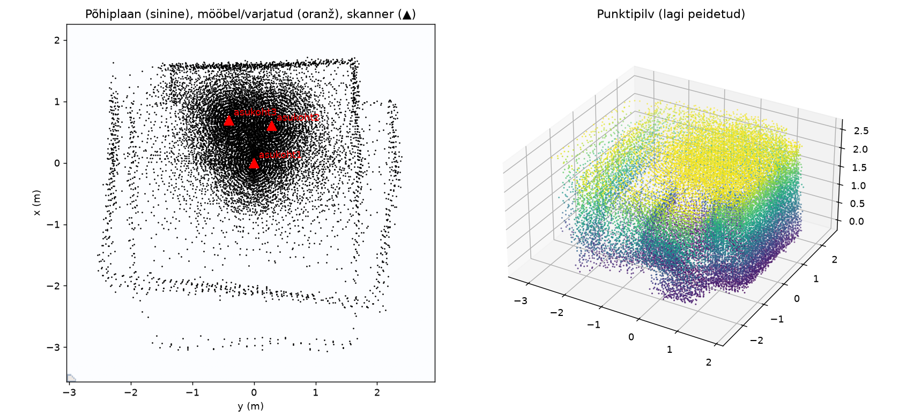
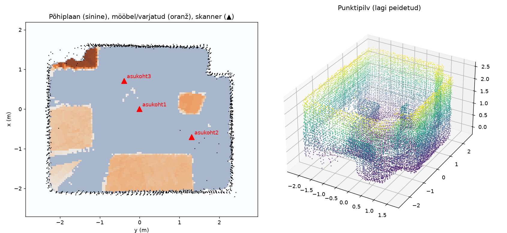

# Accuracy progress

How the results improved once the simulator learned to make the same mistakes as real hardware.

The first prototype was only ever tested on an idealised simulation: servos that point exactly where they are told, a needle-thin laser beam and 1.5 cm of noise. Under those conditions it was about 1 % off. [`src/benchmark.py`](src/benchmark.py) adds the errors a real scanner has, one at a time:

| Scenario | What it simulates |
|---|---|
| ideal | the original simulator (1.5 cm noise) |
| noise 2 cm + 1 % | TF-Luna range noise, growing with distance (estimate from the datasheet) |
| servo backlash 1° | gear play; the scan approaches each angle from alternating sides |
| servo jitter 0.5° | random angle error at every point |
| servo 3 % off | the servo turns 3 % further than commanded |
| beam 2° | the TF-Luna beam is ~2° wide, so at edges it averages the near and far surface |
| all of the above | everything at once, the closest to a real scanner |

The room is 4.6 × 3.7 × 2.55 m (**42.33 m³**) with a column and four pieces of furniture (**4.03 m³**). Each scenario is scanned from 3 positions, 5 times with different random seeds.

## Before and after: all errors at once

Same simulated scan, analysed by the first prototype and by the current code.

**First prototype:** room volume **0.04 m³**



The dark blob around the scanners is ceiling points. With more noise the ceiling was estimated a few cm too high, so ceiling hits leaked into the "walls near the ceiling" layer that the floor plan is drawn from. Those false walls sat right on top of the scanner positions, the flood fill had nowhere to start, and the floor area came out as 0.02 m². The same false walls confused the alignment, so positions 2 and 3 landed in the wrong place (wall overlap −18 % and −78 %): see the doubled walls.

**Now:** room volume **40.21 m³** (−5.0 %), furniture 3.64 m³



## Room volume error, step by step

Mean error over 5 runs (worst run in brackets).

| Scenario | First prototype | 1. Floor/ceiling | 2. Noise | 3. Calibration | 4. Flying points (now) |
|---|---|---|---|---|---|
| ideal | −1.1 % (−1.7) | −1.3 % (−2.2) | −1.0 % (−1.3) | −1.1 % (−1.9) | **−1.2 % (−2.0)** |
| noise 2 cm + 1 % | −99.9 % (−99.9) | −15.4 % (−37.7) | −2.0 % (−2.5) | −2.5 % (−3.9) | **−2.5 % (−3.8)** |
| servo backlash 1° | −0.8 % (−1.4) | −1.6 % (−2.1) | −0.6 % (−1.0) | −0.9 % (−2.0) | **−0.8 % (−2.0)** |
| servo jitter 0.5° | −1.7 % (−3.2) | −2.2 % (−3.6) | −1.6 % (−2.9) | −1.3 % (−3.0) | **−1.3 % (−2.7)** |
| servo 3 % off | −85.1 % (−99.9) | −14.1 % (−26.9) | −8.7 % (−10.7) | −1.4 % (−2.4) | **−1.4 % (−2.4)** |
| beam 2° | −4.0 % (−4.3) | −4.3 % (−4.8) | −3.3 % (−4.1) | −3.5 % (−4.5) | **−1.7 % (−2.7)** |
| all of the above | −99.9 % (−99.9) | −36.3 % (−50.3) | −9.7 % (−10.8) | −4.9 % (−6.0) | **−4.0 % (−5.2)** |
| runs with an alignment warning | 16 / 35 | 14 / 35 | 7 / 35 | 0 / 35 | **0 / 35** |

## Furniture volume, step by step

Mean of 5 runs, true value 4.03 m³. It is expected to come out slightly large, because space that no scanner saw counts as furniture.

| Scenario | First prototype | 1. Floor/ceiling | 2. Noise | 3. Calibration | 4. Flying points (now) |
|---|---|---|---|---|---|
| ideal | 4.31 | 4.33 | 4.15 | 4.15 | **4.15** |
| noise 2 cm + 1 % | 0.04 | 4.08 | 4.12 | 4.06 | **4.08** |
| servo backlash 1° | 4.34 | 4.30 | 4.18 | 4.10 | **4.18** |
| servo jitter 0.5° | 4.36 | 4.36 | 4.19 | 4.22 | **4.29** |
| servo 3 % off | 0.18 | 2.02 | 2.57 | 4.13 | **4.12** |
| beam 2° | 3.24 | 3.19 | 3.33 | 3.33 | **4.06** |
| all of the above | 0.04 | 2.67 | 2.94 | 3.34 | **3.84** |

## What each step changed

1. **Floor/ceiling estimate and flood-fill start** (commit `800b313`). The ceiling was taken from the noisy upper edge of its histogram peak instead of the top of the peak, so it moved up with noise. The flood fill also started from the single pixel under the scanner, which one stray point could block. Now the peak top is used, and the fill starts from the biggest free area within 0.5 m of the scanner. This removed the total failures.
2. **Noise.** Each range is replaced by the median of its 3×3 neighbouring beams, but only if that median is within 20 cm, so object edges don't move. This roughly halves the noise. With 2 cm + 1 % noise (5 cm at 3 m), alignment now works with no warnings. The floor plan also now reaches the centre of the wall pixels instead of stopping one pixel short.
3. **Servo calibration.** `kalibreeri` sweeps both servos across a flat wall and fits `r = d / cos(s·(angle − c))`, which gives the level angle and how far each servo really turns. A 3 % servo error dropped from −8.7 % to −1.4 %.
4. **Flying points.** Where a 2° beam half-hits an edge, the sensor reports a point floating between the near and the far surface. Those rays carved free space out of the furniture. Such points form a "veil" along the beams, so points whose surface is seen at more than 75° from head-on are removed. Furniture with a wide beam went from 3.33 to 4.06 m³.

## Caveats

- **One room.** Every number here comes from the same simulated room. The fixes may suit this room better than others; an L-shaped and a larger room would be the next test.
- **Calibration in the benchmark.** In the first three columns the analysis was given the exact level angle for free, but it knew nothing about servo scale. From step 3 on, the benchmark calibrates on a simulated wall with the same errors, like a real user would. That is why some scenarios without a servo-scale error got slightly worse at step 3.
- **Estimated noise.** The noise levels are estimates. Measuring the real TF-Luna (repeated `READ` at a wall) would show which row matters.
- **Not simulated:** mirrors, windows, dark surfaces, open doors.
- **No real hardware yet.** The calibration was tested only against a simulated ESP32.

## Reproduce

```
cd src
python benchmark.py      # the "now" column, ~4 min
```

The earlier columns were measured with the same benchmark run against the older analysis code.
