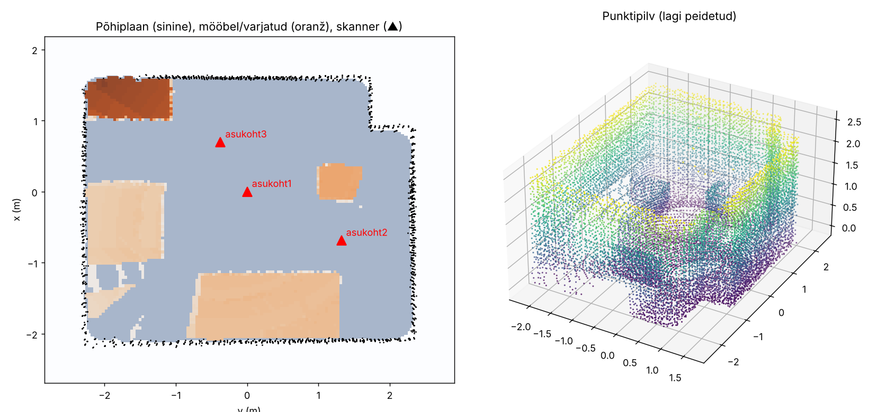

# Room volume with a LiDAR scanner (even with furniture in the room)

An ESP32 turns a LiDAR with two servos and measures the room in every direction. The room is scanned from several positions, and a program on the computer merges the scans, finds the floor, ceiling and walls, and calculates:

- **room volume**: the space between the walls, floor and ceiling, regardless of furniture
- **free air volume**
- **volume of furniture and hidden areas**

You don't need to measure where the scanner stood: the program works this out from the shape of the walls.

## How the measurement works, in simple terms

**1. One beam gives one point.** The TF-Luna is a laser rangefinder: it measures how far away the thing it points at is. The servos turn it left–right (pan) and up–down (tilt), so the program always knows which way the beam went. Direction + distance = one point on a wall, the floor, the ceiling or a piece of furniture. Repeat this every 2° in all directions and you get a cloud of about 16,000 points per position.

**2. Several positions are merged into one.** From one spot you can't see behind furniture, so the room is scanned from 3–4 places. Each scan comes out in its own coordinates, because the program doesn't know where you put the scanner. It turns and shifts the scans until their walls line up, like laying sheets of tracing paper on top of each other until the drawings match. Only the top part of the walls, near the ceiling, is used for this, because furniture rarely reaches that high.

**3. Room volume = floor area × height.** The floor and the ceiling are the lowest and the highest large flat surfaces, and the distance between them is the height. The floor plan is drawn from the wall points just under the ceiling, above the furniture, so the walls are known even where a wardrobe stands in front of them.

**4. A beam proves that the air it passed through is empty.** On its way to the point it hits, the beam flies through empty air. So the space between the scanner and every measured point is known to be free. The program divides the room into 4 cm cubes. A cube that some beam passed through is air. Everything else is either furniture or space that no scanner could see.

```
+----------------------------------------------+
|                 *              *             |
|              .           .                   |
|           .        .                         |
|        .     .                          ? ?  |
|     .  .                +---------+ ? ? ? ?  |
|  S . . . . . . . . . . *| cabinet | ? ? ? ?  |
|     .  .                +---------+ ? ? ? ?  |
|        .     .                          ? ?  |
|           .        .                         |
|              .           .                   |
|                 *              *             |
+----------------------------------------------+

S  scanner (top view)
.  a beam passed here    -> known to be air
*  the beam hit a surface -> one point in the cloud
?  no beam reached here  -> counted as "furniture or hidden"
```

This is why more positions help: a scanner placed on the other side of the cabinet sees the `?` area, and that space moves from "hidden" to "air".

### Example result

A simulated 4.6 × 3.7 × 2.55 m room with four pieces of furniture, scanned from 3 positions ([`examp/`](examp/)):



- **Left, floor plan from above.** Blue is the floor area. Black dots are the wall points near the ceiling. Orange is furniture or hidden space (darker = taller). Red ▲ marks the scanner positions. The notch in the top-right corner is a column, and it correctly counts as part of the wall, not as furniture.
- **Right, the merged point cloud.** The ceiling is hidden so you can see inside.

| | Actual | Measured ([`simuleeritud_tulemus.txt`](examp/simuleeritud_tulemus.txt)) |
|---|---|---|
| Room volume | 42.33 m³ | 41.76 m³ |
| Free air | 38.30 m³ | 37.49 m³ |
| Furniture + hidden | 4.03 m³ | 4.27 m³ |

Technical details are under [How it works (technical)](#how-it-works-technical).

## Folders

```
three-dim/
├── esp32/lidar_skanner/lidar_skanner.ino   ESP32 firmware
├── src/
│   ├── ruumala.py                          RUN: all commands (scan, calibrate, compute, simulate)
│   ├── benchmark.py                        RUN: accuracy over many simulated scans
│   ├── processing/                         measurements -> result
│   │   ├── geometry.py                     raw data -> 3D points, levelling, floor/ceiling, helpers
│   │   ├── registration.py                 aligning scans from different positions
│   │   └── analysis.py                     floor plan, volumes, output files
│   ├── hardware/
│   │   └── scanner.py                      serial link to the ESP32
│   ├── simulation/
│   │   └── simulator.py                    test data without hardware (+ optional servo/LiDAR errors)
│   └── requirements.txt
└── examp/                                  example result from a simulated room
```

## Hardware (about €40–50)

| Part | Note |
|---|---|
| ESP32 dev board | |
| TF-Luna LiDAR | 0.2–8 m, UART |
| 2× servo (MG996R or DS3218) + pan-tilt bracket | metal-gear servos are more accurate |
| 5 V / 2–3 A power supply for the servos | **don't power the servos from the ESP32** |
| Light tripod or tall stand | scanner at ~1–1.5 m height |
| Spirit level (bubble level) | the scanner must be level |

### Wiring

| Device | ESP32 |
|---|---|
| TF-Luna 5V / GND | 5V / GND |
| TF-Luna RXD (pin 2) | GPIO 17 |
| TF-Luna TXD (pin 3) | GPIO 16 |
| Pan servo signal | GPIO 13 |
| Tilt servo signal | GPIO 14 |
| Servo power | external 5 V, **also connect its negative to ESP32 GND** |

### Mechanics

- The pan servo rotates horizontally 0–180°, the tilt servo vertically 0–180°.
- Mount the LiDAR so that it points straight ahead (level) when the tilt servo is at **60°**. The beam then sweeps from 60° below the horizon, over the top, to 30° behind, which gives the two halves some overlap. If your mounting is different, find the right angle with the `kalibreeri` command and pass it as `--tilt-horizon`.
- If a larger tilt angle moves the beam down instead of up, use `--tilt-dir -1`.

## Installation

1. Arduino IDE: install the **ESP32Servo** library and upload `lidar_skanner.ino` to the board.
2. On the computer: `pip install -r src/requirements.txt`

## Usage

```
cd src

# 0) try it first without hardware (simuleeri = simulate, arvuta = compute)
python ruumala.py simuleeri
python ruumala.py arvuta sim_skaneeringud
python benchmark.py          # accuracy over many simulated scans, with servo/LiDAR errors (~5 min)

# 1) calibrate (once)
python ruumala.py kalibreeri --port COM3

# 2) scan at each position (halves A and B; rotate the base 180° by hand in between)
python ruumala.py skanni --port COM3 --nimi asukoht1
python ruumala.py skanni --port COM3 --nimi asukoht2
python ruumala.py skanni --port COM3 --nimi asukoht3

# 3) compute
python ruumala.py arvuta skaneeringud
```

Results are written to the `skaneeringud/` folder:
- `tulemus.txt`: volumes and the registration log
- `tuba.png`: floor plan (furniture in orange) and 3D point cloud
- `tuba.ply`: point cloud that can be opened e.g. in the free program CloudCompare

On Linux the port is usually `/dev/ttyUSB0`. Scanning one half at 2° steps takes about 5–6 minutes. `--samm 3` (step) makes it about twice as fast, but slightly less accurate.

## Tips

- **3–4 positions** give a good result. Pick them so that you can see behind every piece of furniture from at least one position.
- From each new position, **at least two walls** must be visible that were also visible from the earlier positions.
- Rotate the base **in place** (mark its spot on the floor with tape), because the two halves must share the same axis.
- Close the doors and don't move in front of the scanner while it is scanning.
- Mirrors and windows create false points. The program tolerates small holes, but large mirrors are better covered.
- A `<- KONTROLLI!` ("check!") mark in the log means the alignment of some position was uncertain. Look at `tuba.png`: if the walls are doubled, rescan that position.

## How it works (technical)

1. **Points**: `x = r·cos φ·cos θ`, `y = r·cos φ·sin θ`, `z = r·sin φ` (θ = pan, φ = tilt − level angle).
2. **Levelling**: in each scan the ceiling plane is found with RANSAC and rotated to be exactly horizontal.
3. **Registration**: positions are added greedily. The initial guess comes from FFT correlation of a top-view wall image (all rotations in 2° steps), refined with 4-DOF point-to-plane ICP. Poses are scored by wall overlap and **contradictions**: a wall must not be in a place that some scanner saw as empty. The exact angle between halves A and B is also computed.
4. **Floor and ceiling**: the lowest and highest large horizontal surface.
5. **Floor plan**: wall points near the ceiling (above the furniture). Holes are closed, the interior is flood-filled starting from the scanner positions, and the area is summed up. This way the walls automatically extend behind cabinets.
6. **Room volume** = area × height.
7. **Free air**: the room is divided into 4 cm cubes. A cube is free if some scanner saw past it. The rest is furniture or hidden area.

## Test results (simulator)

Simulated room: 4.6 × 3.7 × 2.55 m, with a column in one corner, a wardrobe, a sofa, a chest of drawers and a shelf. The data has ±1.5 cm measurement noise, the scanner is tilted by up to 1°, and the base is rotated by hand with up to ±12° error.

| | Actual | Measured (10 runs) |
|---|---|---|
| Room volume | 42.33 m³ | 41.7–42.3 m³ |
| Furniture | 4.03 m³ | 4.1–4.4 m³ (3–4 positions), ~5 m³ (2), ~7 m³ (1) |

The furniture volume always comes out slightly larger than the actual value, because it also includes areas that no scanner saw. With real hardware, servo inaccuracy (±1°) and errors from reflective surfaces are added on top, so expect an accuracy of about 2–5%.
